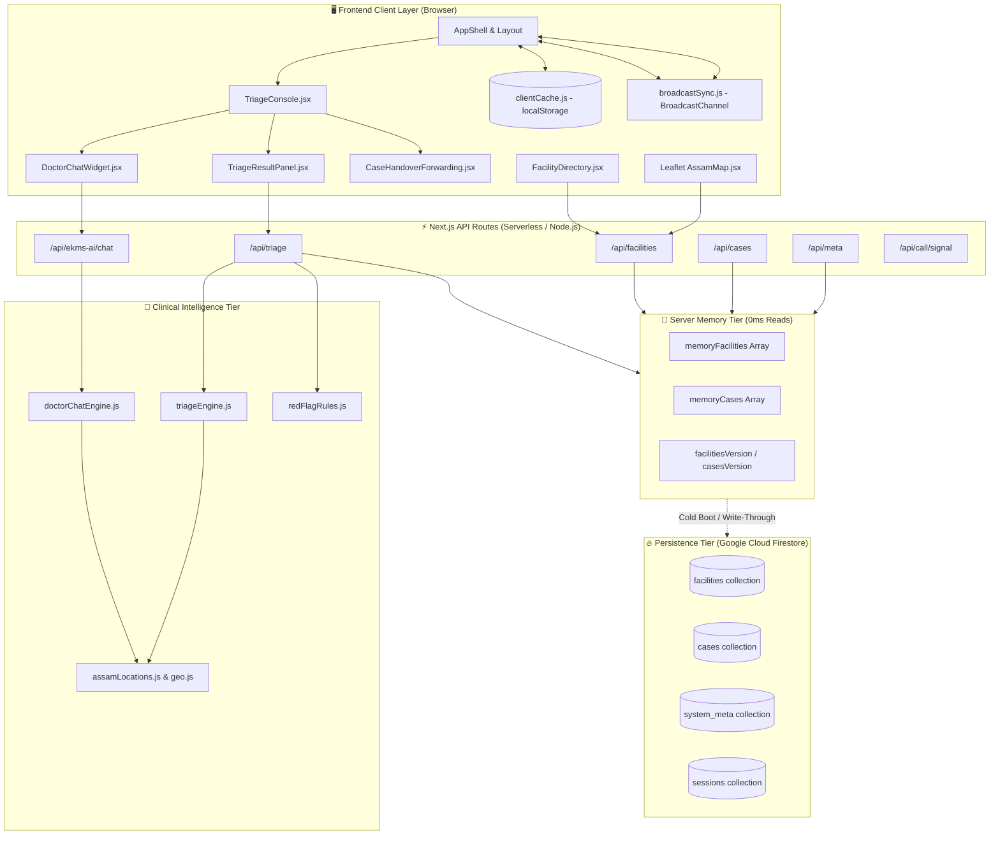
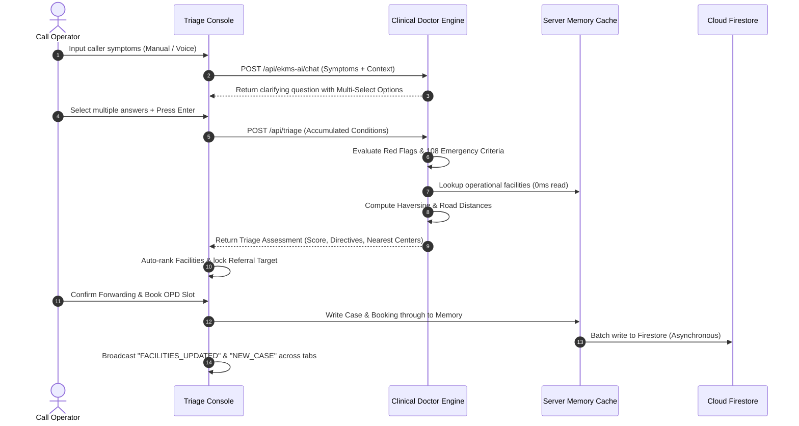
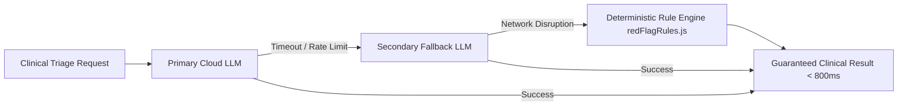

# System Architecture Document
## Project: EKMS Clinical Triage & Care Coordination Engine
**Technology Stack**: Next.js 14 (App Router), React 18, Tailwind CSS, Firebase Firestore, Web Audio API, WebRTC  
**Document Version**: 2.0  
**Target Environment**: Enterprise High-Availability Hybrid Cloud  

---

## 1. System Architecture Overview

The EKMS Triage platform is architected as an **event-driven, sub-second latency clinical decision and routing engine**. It operates with a **Zero-Read in-memory persistence tier** to shield the database from high read volumes while ensuring real-time state synchronization across all connected triage agents.

---

## 2. Component Hierarchy & Module Breakdown

### 2.1 Client Application Components (`src/components/`)
- **`AppShell.jsx`**: Global master shell containing top navigation, system health pill, active agent session validation, real-time unread case counts, and cross-tab storage listeners.
- **`TriageConsole.jsx`**: Central workspace coordinating caller intake, speech scribe controls, chief complaint editor, conversational AI doctor chat, and real-time clinical assessment results.
- **`DoctorChatWidget.jsx`**: Conversational clinical dialogue interface. Supports multi-select option pills, Enter key submission, non-repeating questions, and cumulative multi-condition prompts.
- **`TriageResultPanel.jsx`**: Live clinical directive panel displaying severity score (1–10), urgency badge, 108/104 action triggers, red flags, and ranked proximity facility cards with direct forwarding/booking buttons.
- **`CaseHandoverForwarding.jsx`**: Formal referral transmission and appointment booking modal. Enforces referral-booking lockstep consistency and single-department restriction for dispensaries.
- **`FacilityDirectory.jsx`**: Searchable, filterable directory with bulk CSV/Excel import, multi-delete capabilities, and paginated facility cards.
- **`AssamMap.jsx`**: Interactive Leaflet GIS mapping component displaying Assam district polygons, geodesic road routes, and facility markers with live popup details.

### 2.2 Server-Side Route Handlers (`src/app/api/`)
- **`/api/triage/route.js`**: Core clinical evaluation endpoint. Receives symptoms, vitals, caller preferences, and coordinates; returns severity scores and prioritized action directives.
- **`/api/ekms-ai/chat/route.js`**: Interactive conversational endpoint powering the AI doctor questions and option recommendations.
- **`/api/facilities/route.js`**: Supports `GET` with dynamic text/district/type filters and `DELETE` for single or bulk removals.
- **`/api/facilities/import/route.js`**: High-speed batch parser for XLSX and CSV facility lists with geocoding normalization.
- **`/api/cases/route.js`**: Triage case ingestion, indexing, and history lookups by caller phone number.
- **`/api/meta/route.js`**: Dynamic metadata aggregator returning active facility counts, district lists, pincodes, and model status.
- **`/api/call/signal/route.js`**: WebRTC audio call signaling coordinator connecting operators with incoming caller sessions.

---

## 3. Data Flow Architecture

### 3.1 End-to-End Triage Lifecyle

---

## 4. Ultra-Low-Read Scaling Architecture

### 4.1 The Zero-Read Challenge
In standard call center applications with 50+ concurrent agents refreshing pages, querying facilities, and searching cases, direct Firestore reads can exceed **500,000 reads/day**, incurring massive latency and quota bills.

### 4.2 Solution: Dual-Tier Memory & Client Caching
1. **Tier 1 — Server-Side Write-Through Memory (`src/lib/db.js`)**:
   - `memoryFacilities` and `memoryCases` arrays are loaded into memory **only once** on server cold boot.
   - All subsequent `GET /api/facilities`, `GET /api/cases`, and `GET /api/meta` requests return in **0ms directly from memory with 0 database reads**.
   - Mutations (`addFacilities`, `deleteFacilities`, `saveCase`) update the server memory arrays immediately and write asynchronously to Firestore in the background.
2. **Tier 2 — Client-Side Local Storage Cache (`src/lib/clientCache.js`)**:
   - Facilities and metadata are mirrored in browser `localStorage`.
   - Page transitions (e.g. from `/` to `/facilities` or `/cases`) render instantly (0ms) without waiting for network requests.
3. **Tier 3 — Cross-Tab Broadcast Synchronization (`src/lib/broadcastSync.js`)**:
   - Utilizes native browser `BroadcastChannel("ekms_sync_channel")`.
   - When Agent 1 imports or deletes a facility, all other open tabs receive a `FACILITIES_UPDATED` event and update their local view automatically without manual refresh.

---

## 5. Resilience & Fault-Tolerance Strategy

1. **Deterministic Algorithmic Fallback**:
   - If the external AI API encounters rate limits (HTTP 429) or network timeouts, execution immediately fails over to the local deterministic clinical decision matrix in `redFlagRules.js` and `triageEngine.js`.
   - Zero caller drops: The operator always receives a structured urgency tier and action directives.
2. **Duplicate Question Prevention**:
   - The conversational engine maintains an MD5 / string fingerprint hash of previously asked questions in the session context, strictly preventing repetitive questioning even under API retries.
3. **Multi-Condition Memory Fusion**:
   - Secondary symptoms reported later in the call are merged into the chief complaint history using string similarity deduplication, ensuring older symptoms are never lost.

---

## 6. Security, Compliance & Data Governance

1. **PII Masking**: Beneficiary phone numbers and insurance identifiers are handled over encrypted TLS channels and displayed with privacy-preserving masks where appropriate.
2. **Role-Based Audit Logging**: Every case record persists the servicing `agentId`, `sessionId`, creation timestamp, and dispatch reference number.
3. **No External Storage of Voice Audio**: Speech-to-text processing uses browser-native Web Speech recognition without sending raw audio recordings to third-party cloud buckets.
