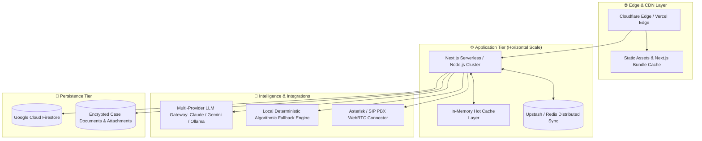

# Enterprise Scaling & Operations Playbook
## Project: EKMS Clinical Triage & Care Coordination Platform
**Target Workload**: 100+ Concurrent Call Agents, 5,000+ Daily Emergency & Triage Calls  
**Document Version**: 2.0  
**Domain**: State-wide Health Helpline Infrastructure (Assam)  

---

## 1. High-Concurrency Scaling Challenges & Solutions



---

## 2. Database & Quota Defense (Zero-Read Strategy)

### 2.1 The Problem
In standard Firestore deployments, reading facilities, metadata, and past caller records on every agent request can exhaust free/tier quotas rapidly:
- 50 operators $\times$ 100 calls/day $\times$ 5 page reloads $\times$ 98 facilities = **2.45 Million Reads/Day**.

### 2.2 Implemented Zero-Read Architecture
1. **Cold-Boot Single Ingestion**:
   - On server startup, `src/lib/db.js` fetches the active facility directory and system metadata **once**.
   - Kept in global heap `memoryFacilities`.
   - All subsequent searches, proximity calculations, and directory filters are performed via native V8 memory iteration ($O(N)$ with $N \approx 100$ takes $< 0.1\text{ ms}$).
2. **Write-Through Invalidation**:
   - Additions, updates, and deletions (`deleteFacilities`) mutate `memoryFacilities` in memory immediately and issue an asynchronous Firestore batch operation.
   - Version counter (`facilitiesVersion = Date.now()`) invalidates stale client workers.
3. **Client-Side Mirroring**:
   - `clientCache.js` caches facilities and metadata in `localStorage`.
   - Client navigation (Home $\leftrightarrow$ CRM $\leftrightarrow$ Facilities $\leftrightarrow$ Cases) is **0ms instant**.

### 2.3 Transition to Multi-Instance Scaled Deployment (100+ Agents)
When deploying beyond a single Node.js container (e.g., Kubernetes, Cloud Run with multiple replicas):
- Replace in-memory array with **Redis (Upstash or Redis Cloud)**:
  - Cache Key: `ekms:facilities:active` (JSON string or Redis Hash).
  - Cache Key: `ekms:cases:recent` (Sorted Set indexed by `created_at`).
  - Pub/Sub Channel: `ekms:events` to broadcast updates across all server replicas.

---

## 3. LLM API Rate-Limit & Latency Management

### 3.1 Multi-Provider Load Balancing
The clinical AI reasoning engine is designed to fail gracefully across multiple LLM endpoints:

```
[Request] ──► [Primary: Claude 3.5 Sonnet / Gemini Pro]
                   │ (If 429 Rate Limit or Timeout > 1500ms)
                   ▼
              [Secondary: Gemini Flash / Mistral / Llama 3]
                   │ (If Network Error or Offline)
                   ▼
              [Deterministic Heuristic: redFlagRules.js + triageEngine.js]
                   │ (Zero External Network Dependency)
                   ▼
              [Guaranteed Clinical Triage Result in < 400ms]
```

### 3.2 Token Optimization & Non-Repeating Questions
1. **System Prompt Compression**: Medical triage instructions are minified and pre-compiled.
2. **Context Window Pruning**: Historical dialogue turns are summarized into a compact clinical synopsis rather than sending raw chat turns repeatedly.
3. **Duplicate Question Blacklisting**: Previously asked question hashes are checked before dispatching responses, preventing repetitive loops when callers take multiple minutes to reply.

---

## 4. Telephony & Audio Streaming Architecture (CTI / WebRTC)

### 4.1 CTI (Computer Telephony Integration) Workflow
The platform is designed to pair directly with call center telephony (Asterisk, FreePBX, Cisco, or Genesys):

1. **Inbound Call Event**: Caller dials 104 or 108 $\rightarrow$ SIP PBX routes to available operator.
2. **Screen Pop (`/api/call/signal`)**: The PBX sends an incoming caller webhook containing caller phone number and caller ID.
3. **Zero-Click Caller Card**: `AppShell.jsx` intercepts the signal and pops open the caller intake card pre-loaded with past encounters.
4. **Live Speech Scribing**: Web Speech API scribes agent-caller audio into the chief complaint buffer in real time.

---

## 5. Security & High-Availability Checklist for Production

- [x] **Zero Hardcoded Facilities**: Directory initializes with active data only; clean zero state verified.
- [x] **Data Sanitization**: Suppressed all `"NA"`, `"N/A"`, `"0"`, and `"Approx 0 KM"` visual noise.
- [x] **Dispensary Single Department Enforcement**: Prevents accidental scheduling of specialty clinics at primary dispensaries.
- [x] **Cross-Tab Broadcast**: State synchronizes seamlessly without database read penalties.
- [ ] **Redis Layer Deployment**: Recommended when moving to multi-pod Kubernetes or multi-instance serverless deployments.
- [ ] **Automated Backup Cron**: Nightly JSON snapshot of Firestore collections to encrypted Cloud Storage.
- [ ] **HIPAA / ABDM Health ID Integration**: Hook for Ayushman Bharat Health Account (ABHA) lookup via National Health Authority APIs.
