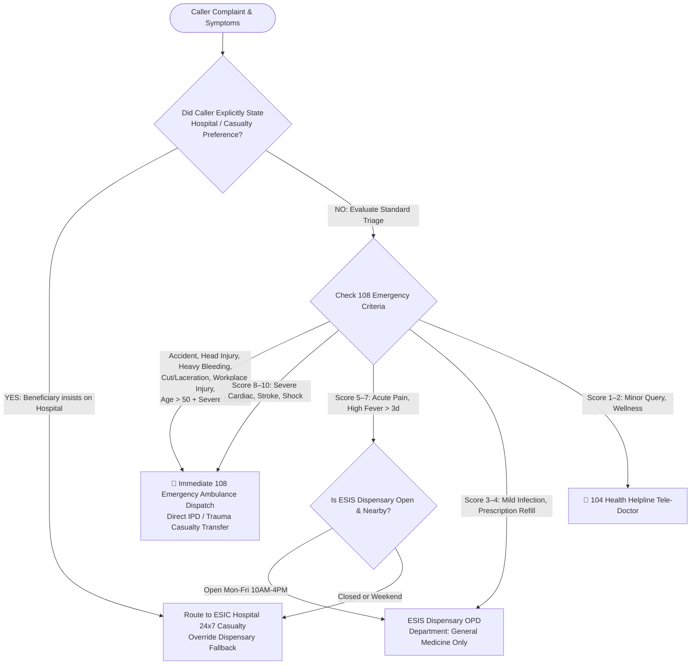

# Clinical Forwarding, Handover & Emergency Dispatch Rules
## Project: EKMS Clinical Triage & Care Coordination Platform
**Operational Jurisdiction**: ESIC / ESIS Care Coordination Centre, Assam  
**Document Version**: 2.0  
**Authority**: Clinical Decision Support Standards  

---

## 1. High-Level Forwarding Matrix



---

## 2. 108 Emergency Ambulance Dispatch Protocol

The **108 Emergency Ambulance Service** is activated immediately whenever an assessment matches critical life-safety or trauma criteria. Under these conditions, routine dispensary routing is strictly forbidden.

### 2.1 Compulsory 108 Trigger Criteria

| Category | Specific Clinical Presentation | Action Mandate |
|---|---|---|
| **Accidents & Trauma** | Road traffic accidents (RTA), vehicular collisions, falls from height, pedestrian trauma. | Immediate 108 Ambulance mobilization; instruct caller to remain still; dispatch to nearest trauma center. |
| **Head Injury** | Concussion, blunt head impact, loss of consciousness, skull trauma, post-traumatic vomiting or confusion. | 108 Ambulance dispatch; monitor airway and cervical spine. |
| **Heavy Bleeding & Hemorrhage** | Arterial or pulsatile bleeding, uncontrolled bleeding failing direct pressure, heavy gastrointestinal bleeding (hematemesis/melena). | 108 Ambulance; instruct caller on firm wound compression. |
| **Cuts, Lacerations & Industrial Trauma** | Deep hand/finger cuts, severed tendons, heavy machinery cuts, factory crush injuries, amputations. | 108 Ambulance; elevate injured limb; transport severed parts in clean, chilled container. |
| **Elderly Severe Distress (Age > 50)** | Any caller aged > 50 presenting with acute severe symptoms (fever with lethargy, sudden severe weakness, shortness of breath, acute chest discomfort). | Automatic escalation to 108 Ambulance due to high cardiac and sepsis vulnerability. |
| **Acute Cardiac Symptoms** | Crushing retrosternal chest pain, radiation to left arm/jaw/back, cold diaphoresis, dyspnea. | Immediate 108 dispatch; instruct caller to sit upright and avoid physical exertion. |
| **Respiratory Failure** | Gasping, cyanosis (blue lips/nails), inability to speak full sentences, acute severe asthma. | Immediate 108 dispatch with oxygen-equipped ambulance. |

---

## 3. Beneficiary Stated Preference Override Rule

### 3.1 The Problem
In standard algorithmic triage, a non-emergency score (such as Score 4 or 5) might default to an ESIS Dispensary. However, if the caller explicitly states:
- *"I want to go to the hospital"*,
- *"Take me to ESIC hospital casualty"*, or
- Selects the *"Visit ESIC Hospital Casualty now"* option pill,
routing them to a primary care dispensary causes severe caller frustration and delays appropriate hospital evaluation.

### 3.2 The Policy Rule
Whenever the caller's dialogue, selected option, or manual input indicates an explicit preference for a **Hospital** or **Casualty**:
1. **Dispensary Fallback Overridden**: The primary referral destination resolves directly to **`ESIC Hospital`** (or nearest Govt Medical College / District Hospital).
2. **Directive ID Setting**: Sets `call_referral_primary = "ESIC Hospital"` and flags directive `ESIC_HOSPITAL` as Primary.
3. **Card Placement**: Pins the target hospital to the top (Index 0) of the facility list with an active reference badge.

---

## 4. ESIS Dispensary Handover & Department Rules

### 4.1 Operating Scope & Timing
- **Operational Days**: Monday to Friday (10:00 AM – 4:00 PM).
- **Weekend Status**: Closed on Saturdays afternoon and Sundays. If a patient is evaluated on a weekend, the system warns the operator and redirects to a 24x7 hospital.

### 4.2 Single Department Booking Restriction
- **Mandate**: When booking an OPD appointment at an **ESIS Dispensary**, the system displays **only one department**:
  $$\text{Department} = \textbf{General Medicine / Primary Care OPD}$$
- **Rationale**: ESIS Dispensaries are primary care gatekeeper clinics staffed by Medical Officers (MBBS). They do not house independent tertiary specialty departments.
- **Suppressed Clinics for Dispensaries**:
  - Diabetic & NCD Specialty Clinic *(Hospital level)*
  - Pediatrics & Child Health *(Hospital level)*
  - Emergency Casualty & Observation *(Hospital level)*
  - Dental OPD *(Hospital level)*
  - Orthopedics & Physical Medicine *(Hospital level)*
  - Obstetrics & Gynecology (OBG) *(Hospital level)*

---

## 5. ESIC Hospital & Tie-Up Facility Handover Rules

### 5.1 Operating Scope
- **Casualty & Inpatient (IPD)**: Operates **24 Hours a day, 7 Days a week (24x7)**.
- **Hospital OPD Specialty Clinics**: Available Monday through Saturday for multi-specialty evaluations (OBG, Ortho, Pediatrics, NCD, Dental).

### 5.2 Emitted Data on Handover
When transmitting a summary to an ESIC Hospital or Tie-Up Center:
1. Complete Chief Complaint with symptom onset duration.
2. List of identified Red Flags.
3. Insured Person (IP) number and employer unit code (if recorded).
4. Estimated arrival time and travel distance from caller incident coordinate.

---

## 6. Referral & Booking Lockstep Consistency Protocol

To prevent coordination errors where a clinical summary is emailed/forwarded to Facility A but the patient arrives with an appointment token at Facility B:

```
[Clinical Summary Forwarded to Facility X]
                  │
                  ▼
[Appointment Booking STRICTLY LOCKED to Facility X]
                  │
                  ▼
[Unified Reference Code: ESIC-XXXX-YYMMDD-ZZZZ]
```

1. **Forwarded First**: If the operator transmits the case summary to Facility X, the booking dropdown is locked to Facility X with an emerald indicator:
   `"✓ Appointment can only be booked at Facility X because clinical summary has already been transmitted there."`
2. **Booked First**: If the operator books an OPD appointment at Facility Y first, summary forwarding is locked to Facility Y with an orange indicator:
   `"✓ Clinical summary can only be forwarded to Facility Y because an OPD appointment has already been booked there."`
3. **Override Workflow**: If the caller changes their mind, the operator must explicitly cancel or modify the existing dispatch before routing to a different facility.

---

## 7. Unified Reference Number Standards

All dispatches and appointments generate an enterprise tracking code adhering to the following syntax:

| Destination Type | Code Pattern | Example Code |
|---|---|---|
| **108 Ambulance Dispatch** | `108-EMERG-[YYMMDD]-[RANDOM4]` | `108-EMERG-261014-9B2F` |
| **ESIS Dispensary** | `ESIC-DISP-[YYMMDD]-[RANDOM4]` | `ESIC-DISP-261014-41A8` |
| **ESIC Hospital** | `ESIC-HOSP-[YYMMDD]-[RANDOM4]` | `ESIC-HOSP-261014-87C1` |
| **Govt District Hospital** | `GOVT-HOSP-[YYMMDD]-[RANDOM4]` | `GOVT-HOSP-261014-33D4` |
| **Tie-Up Private Hospital** | `TIEUP-MED-[YYMMDD]-[RANDOM4]` | `TIEUP-MED-261014-65E2` |
| **104 Tele-Doctor** | `104-TELE-[YYMMDD]-[RANDOM4]` | `104-TELE-261014-12F9` |
